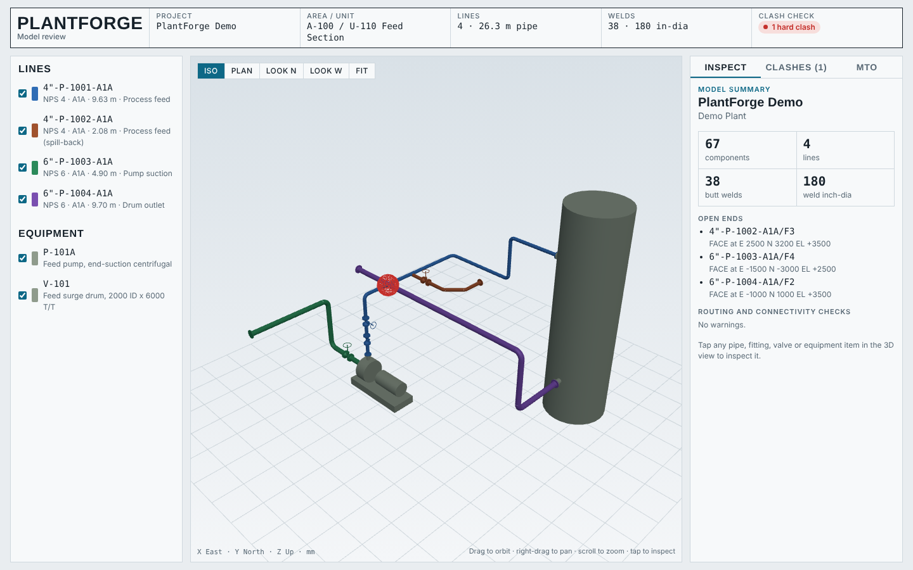
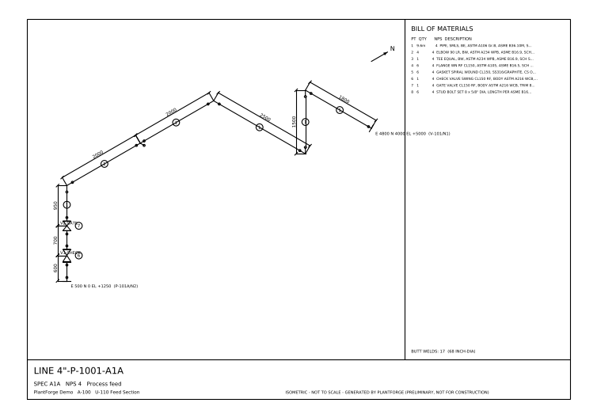

# PlantForge

> **جديد: [PlantForge Studio](studio/README.md)** - البرنامج التفاعلي ثلاثي الأبعاد: رسم المواسير بالماوس، و Auto-routing، و Clash لحظي، وأيزومتريك، ومساعد ذكاء اصطناعي.
> وشكله بقى **Desktop زي E3D**: 3D View غامق، وحديد I-beam، ومسامير الفلانشات، و Platforms، و Model Explorer بشجرة SITE / ZONE / PIPE / BRAN.
> ودلوقتي ليه **قاعدة بيانات SQLite زي SP3D**: Catalog و Specs بتتعدل وتتعمل لها Bulkload، و Approval workflow، و Transactions، وتقارير SQL، و Shared plant لكذا مهندس في نفس الوقت.
> افتح `studio/release/plantforge-studio.html` في المتصفح.

**محرك مفتوح المصدر لتصميم المصانع والأنابيب، شغله ماشي بالـ Spec (Spec-driven)، على طريقة SP3D و E3D.**

ده الإصدار 0.1: نواة البرنامج (Engine). بيقرا موديل المصنع من ملف نصي، ويعمل Routing للخطوط
من الـ Spec والكتالوج، ويطلّع المخرجات اللي مهندس البايبنج محتاجها:

| المخرج | الوصف |
|---|---|
| موديل 3D تفاعلي (`model.html`) | تقدر تعمل Orbit وتختار أي قطعة وتشوف خصائصها، وفيه قائمة الـ Clashes والـ MTO |
| MTO (`mto.csv`) | مواسير بالمتر وفيتنجز وفلانشات وجوانات وبلوف وطقم مسامير، وعدد اللحامات والـ Inch-dia |
| PCF لكل خط (`pcf/*.pcf`) | ملف Piping Component File، الصيغة المحايدة اللي ISOGEN وبرامج الأيزومتريك بتقراها |
| أيزومتريك DXF (`iso/*.dxf`) | أيزومتريك مبدئي لكل خط فيه أبعاد حقيقية و BOM ومربع عنوان، ويفتح على AutoCAD |
| IFC (`model.ifc`) | موديل BIM مفتوح فيه أنظمة ونقاط اتصال (Ports)، ويفتح على Navisworks و Solibri و FreeCAD و Bonsai |
| تقرير فحص (`report.txt`) | الـ Clashes، والأطراف المفتوحة (Open ends)، وتحذيرات الـ Routing |





## البرنامج بيعمل إيه دلوقتي

- **كتالوج قياسي** (`plantforge/data/*.json`): أبعاد المواسير حسب ASME B36.10M، والفيتنجز حسب B16.9،
  وفلانشات WN RF Class 150 حسب B16.5، وأطوال البلوف (Face-to-face) حسب B16.10.
- **Spec (Pipe class)** في ملف TOML (`plantforge/specs/A1A.toml`): بيحدد السكجويل والوصف لكل مقاس، وأنواع البلوف المسموح بيها، وأقل طول للماسورة.
- **Routing تلقائي**: بتدي البرنامج نقاط الـ Centerline، وهو بيحط:
  - Elbow 90 LR و 45 LR، أو كوع 90 متقصّص (Trimmed) لأي زاوية أقل من 90.
  - جوان وفلانشة WN تلقائي عند الاتصال بنوزل.
  - مجموعة البلف كاملة (فلانشة + جوان + بلف + جوان + فلانشة) في الـ Station اللي تحددها.
  - Tee عليه فرع، والفرع يبقى خط مستقل بيبدأ من الـ Tee.
  - المواسير بتملا الفراغات، وبيطلع تحذير لو فيه ماسورة أقصر من الحد الأدنى.
- **أخطاء واضحة** لو حاجة مش راكبة، زي: كوعين متداخلين، أو بلف مش داخل في الـ Leg، أو زاوية أكبر من 90°، أو الخط مش طالع في اتجاه النوزل.
- **Connectivity**: البرنامج بيعرف كل لحام (Butt weld)، والأطراف المفتوحة، واختلاف المقاسات أو نوع الأطراف.
- **Clash detection** بخوارزمية GJK على أشكال محدبة (Convex)، زي برامج الـ Clash التجارية. بيكشف التداخل الفعلي (Hard)، وكمان المسافات الأقل من الـ Clearance اللي تحدده.

## التشغيل السريع

```bash
cd plantforge
pip install -e ".[all]"          # ifcopenshell + ezdxf + pytest (اختيارية)
plantforge build examples/demo_plant.toml -o out
# أو بدون تثبيت:
python -m plantforge build examples/demo_plant.toml -o out
```

افتح `out/model.html` في المتصفح. الموديل التجريبي فيه **Clash مقصود** بين الخطين
`6"-P-1004` و `4"-P-1001`. نزّل الـ Rack run بتاع الخط 1004 من EL 3500 لـ EL 3000 في
`examples/demo_plant.toml`، وشغّل `plantforge check` تاني، هتلاقي الـ Clash اتحل.

```bash
plantforge check examples/demo_plant.toml --clearance 50   # بيرجّع كود 2 لو فيه Clash، ينفع في CI
pytest                                                        # الاختبارات
```

## شكل ملف الموديل

```toml
[[equipment]]
tag = "P-101A"
kind = "pump"
  [[equipment.shapes]]
  type = "box"
  min = [0, -400, 0]
  max = [2200, 400, 250]
  [[equipment.nozzles]]
  name = "N2"
  nps = "4"
  position = [500, 0, 1250]   # وش الفلانشة
  direction = [0, 0, 1]       # اتجاه خروج النوزل

[[lines]]
number = '4"-P-1001-A1A'
spec = "A1A"
nps = "4"
from = "P-101A/N2"            # البرنامج بيضيف نقطة النوزل والجوان والفلانشة لوحده
to = "V-101/N1"
points = [[500, 0, 3500], [500, 4000, 3500], [3000, 4000, 3500], [3000, 4000, 5000]]
  [[lines.inline]]
  type = "gate"               # gate | globe | check | tee
  leg = 0                     # رقم الـ Leg (بيبدأ من صفر)
  station = 1300              # المسافة من بداية الـ Leg لمركز البلف (mm)
```

المحاور: X = شرق، Y = شمال، Z = منسوب (EL)، والوحدة mm.

## هيكل المشروع

```
plantforge/
  plantforge/
    geom.py          الهندسة: Vec3، Cylinder، Frustum، Box، TorusArc
    catalog.py       قراءة الكتالوج والمقاسات (NPS / DN)
    spec.py          الـ Pipe class واختيار القطع
    model.py         Project، Equipment، Pipeline، Component، Port
    parts.py         بناء القطع (Symbols): الماسورة والكوع والـ Tee والفلانشة والجوان والبلف
    routing.py       محرك الـ Routing
    connectivity.py  الاتصالات واللحامات والأطراف المفتوحة
    clash.py         كشف التداخل (GJK)
    mto.py           حصر الخامات
    project_io.py    قراءة ملف الموديل TOML
    export/          PCF، IFC، الأيزومتريك DXF، صفحة العرض 3D
  examples/demo_plant.toml
  tests/
  docs/ROADMAP.md    الخطة الكاملة لحد ما نوصل لمستوى SP3D
```

## حدود الإصدار ده

- مفيش لسه **واجهة رسم تفاعلية**: الموديل بيتكتب في ملف نصي. الواجهة هي المرحلة الجاية (شوف الـ Roadmap).
- Class 150 بس، ومفيش Reducers، ولا Small-bore SW/Threaded، ولا Olets.
- الأيزومتريك مبدئي، ومحتاج لسه ترتيب للأبعاد وتقسيم Spools وشيتات متعددة.
- **بيانات الكتالوج اتجمعت للتطوير بس.** لازم تتراجع على نسختك المرخّصة من الـ ASME، وعلى بيانات الموردين، قبل أي استخدام فعلي.

الخطة الكاملة والمكتبات مفتوحة المصدر اللي هنعتمد عليها موجودة في [docs/ROADMAP.md](docs/ROADMAP.md).
