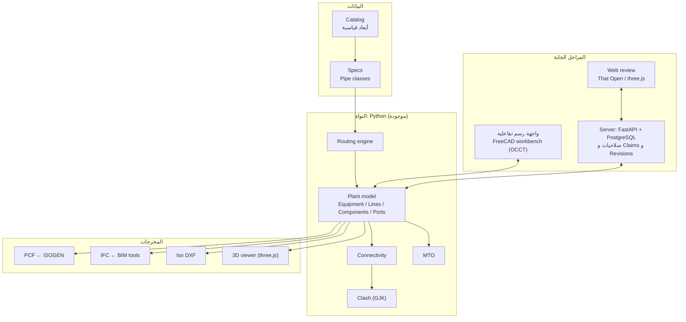

# خطة PlantForge: من محرك صغير لبرنامج بمستوى SP3D

## 1. SP3D فيه إيه، وإحنا هنعمل كل جزء بإيه

| موديول في SP3D | وظيفته | عندنا دلوقتي | هنبنيه بإيه |
|---|---|---|---|
| Catalog / Reference Data | أبعاد القطع والرموز والقواعد | Studio: جداول SQLite بتتعدل من جريد وبـ CSV bulkload، و Re-route تلقائي بعد أي تعديل. محرك Python: JSON | قاعدة بيانات SQLite ثم PostgreSQL، ومحرر كتالوج، واستيراد بيانات الموردين |
| Specs (Pipe classes) | اختيار القطعة المناسبة لكل خدمة ومقاس | TOML بسيط | Branch tables (Tee أو Olet أو Stub-in)، وحدود الضغط والحرارة، والـ Small-bore |
| Piping | Routing وإدخال القطع والقواعد | محرك Routing كامل من النقاط | واجهة رسم تفاعلية، و Reducers، و Slope، و Sloped routing |
| Equipment | معدات بارامترية بنوزلات | Box و Cylinder ونوزلات | Templates بارامترية (طلمبة، Drum، مبادل، عمود تقطير) |
| Interference Check (Database Detect) | كشف التداخل | GJK على أشكال محدبة | BVH للسرعة، وفحص مستمر أثناء الرسم، و OCCT للدقة على الـ B-rep |
| Isometrics (ISOGEN) | الأيزومتريك | PCF، وأيزومتريك DXF مبدئي | تقسيم Spools، وترقيم اللحامات، و Cut lists، وتوزيع الأبعاد، وشيتات متعددة |
| Orthographic Drawings | Plans و Sections | ⛔ | FreeCAD TechDraw أو مولّد خاص بـ ezdxf |
| Reports / MTO | حصر الخامات | MTO لكل خط وللمشروع، ولحامات و Inch-dia، و 15 تقرير SQL جاهز، وكونسول SQL | تقارير Excel، و Line list، و Valve list، والأوزان |
| Hangers & Supports | الدعامات | ⛔ | كتالوج دعامات قياسية، وتوزيع تلقائي من جداول الـ Span |
| Structure | الهياكل المعدنية والـ Pipe racks | ⛔ | كتالوج قطاعات (IPE و HEA و UPN و W-shapes)، وأعمدة وكمرات وبلاطات |
| Electrical / HVAC | Cable trays و Ducts | ⛔ | نفس محرك الـ Routing بكتالوجات تانية |
| Global Workshare / Permissions | شغل جماعي وصلاحيات | Studio: Shared plant لايف، و Leases، و Version check، و Approval status، وسجل Transactions | Server مركزي فيه Claim/Lock وتاريخ تعديلات (Revisions) |
| Smart P&ID integration | مطابقة الـ 3D مع الـ P&ID | ⛔ | استيراد DEXPI XML، وفحص التطابق (خطوط وبلوف وأحجام) |
| Stress interface | تحليل الإجهادات | ⛔ | تصدير لـ CAESAR II (Neutral file)، أو Code_Aster / CalculiX |

## 2. المعمارية (Architecture)

**المبدأ الأساسي:** النواة مش مربوطة بأي واجهة. كل قطعة في الموديل عبارة عن Ports وأشكال (Primitives)،
ونفس التمثيل ده بيستخدمه الـ Viewer والـ IFC والـ Clash والأيزومتريك. فأي واجهة هنعملها بعدين
(Desktop أو Web) هتتكلم مع نفس النواة.

## 3. المكتبات مفتوحة المصدر اللي هنعتمد عليها

| الغرض | المكتبة | الرخصة | ملاحظات |
|---|---|---|---|
| Geometry kernel (B-rep) | **Open CASCADE Technology (OCCT)** | LGPL-2.1 + exception | نفس فئة Parasolid و ACIS. FreeCAD مبني عليه |
| Python bindings لـ OCCT | pythonOCC / CadQuery / build123d | LGPL-3.0 / Apache-2.0 / Apache-2.0 | للأشكال المعقدة والـ STEP |
| منصة CAD جاهزة | **FreeCAD** | LGPL-2.0+ | 3D view واختيار و Undo ومحرر خصائص و TechDraw. هنبني عليه Workbench |
| معيار تبادل الموديل | **IFC 4 / 4.3 عبر IfcOpenShell** | LGPL-3.0 | مستخدمة دلوقتي في `export/ifc.py` |
| رسومات DXF | **ezdxf** | MIT | مستخدمة دلوقتي في الأيزومتريك |
| عرض 3D على الويب | **three.js** | MIT | مستخدمة دلوقتي في `model.html` |
| IFC على الويب | That Open Engine (web-ifc) | MIT / MPL-2.0 | لمراجعة الموديل في المتصفح |
| Viewer بديل | xeokit | AGPL-3.0 | ⚠️ AGPL بتلزمك تفتح كود البرنامج كله لو استخدمته تجارياً من غير رخصة |
| Clash عالي الأداء | FCL (Flexible Collision Library) | BSD-3 | لما الموديل يكبر لعشرات الآلاف من القطع |
| قاعدة البيانات | SQLite ثم PostgreSQL | Public domain / PostgreSQL | الكتالوج والموديل والصلاحيات |
| Server | FastAPI | MIT | الشغل الجماعي |
| تبادل البيانات بين البرامج | Speckle | Apache-2.0 | اختياري: Connectors لـ Revit و AutoCAD وغيرهم |
| P&ID | معيار DEXPI | معيار مفتوح | فيه مكتبات Python مفتوحة لقراءته (راجع رخصة كل واحدة) |
| تحليل إجهادات | Code_Aster / CalculiX | GPL-3.0 / GPL-2.0 | كبرامج خارجية (تصدير واستيراد)، مش مدموجة في الكود |
| واجهة Desktop مستقلة (بديل لـ FreeCAD) | Qt عبر PySide6 | LGPL-3.0 | لو قررنا نعمل برنامج مستقل بالكامل |

> **قبل ما تنسخ كود من أي مشروع:** فيه Workbenches للبايبنج على FreeCAD (زي Dodo و Flamingo) مفيدة كمرجع.
> راجع رخصة كل مشروع قبل ما تنقل منه كود. LGPL و MIT و Apache تمام حتى لو البرنامج تجاري.
> GPL و AGPL بيفرضوا شروط على الكود بتاعك كله.

## 4. القرار المهم: Desktop ولا Web؟

**اللي حصل فعلاً:** الواجهة التفاعلية الأولى اتعملت **على الويب (PlantForge Studio)**، عشان تفتح على أي جهاز من غير تثبيت. المحرك اتنقل لـ TypeScript، وبيستخدم نفس ملفات الكتالوج والـ Spec بتاعة Python. لسه FreeCAD Workbench اختيار قوي لنسخة Desktop تشتغل على OCCT B-rep.

**التوصية الأصلية:** نكمّل النواة Python زي ما هي، والواجهة التفاعلية الأولى تبقى **FreeCAD Workbench**.

- FreeCAD بيدينا Geometry kernel (OCCT)، و 3D view، واختيار، و Undo/Redo، وحفظ ملفات، ومحرر خصائص، ورسومات (TechDraw)، و STEP و IFC ببلاش. ده شغل سنين لو بنيناه من الصفر.
- النواة Python، فتتحط جوه FreeCAD مباشرة من غير إعادة كتابة.
- بعدين نضيف **Server + Web review** للشغل الجماعي والمراجعة (زي Navisworks و SmartPlant Review). الـ `model.html` الحالي هو أول خطوة فيه.

البديل إن الواجهة الأساسية تبقى Web من الأول: أفضل في الشغل الجماعي، بس أصعب بكتير في أدوات الرسم الهندسي الدقيقة.

## 5. المراحل

التقديرات دي لفريق صغير (مهندس بايبنج + مطور أو اتنين). كل مرحلة بتطلّع حاجة تتجرب.

| المرحلة | المحتوى | الناتج |
|---|---|---|
| **0 (تمت)** | النواة: كتالوج و Spec و Routing و Connectivity و Clash و MTO و PCF و IFC وأيزومتريك و Viewer | `plantforge build` على موديل نصي |
| **2 (بدأت): PlantForge Studio** | واجهة تفاعلية على الويب (three.js): Route بالماوس، و Auto-routing بيتجنب الـ Clash ويفضّل الـ Rack، ومعدات بارامترية، و Racks مع Shoes تلقائي، وتحريك مع Stretch، و Clash لحظي، و To-Do list، وأيزومتريك، ومساعد AI، وحفظ في الحساب | برنامج تفاعلي شغّال: `studio/` |
| **قاعدة البيانات (تمت في Studio)** | SQLite: Catalog و Specs و Model objects و Metadata و Transactions و Report views، و Bulkload، و Backup/Restore، و Approval workflow، و Shared plant لايف | Plant database زي SP3D |
| **1: البيانات والقواعد** (1-2 شهر) | Class 300 و 600، و Reducers (Concentric و Eccentric)، و Small-bore SW و Threaded، و Olets و Branch tables، ومحرر Spec، ووحدات inch/mm | Spec حقيقي لشركة يتعمل فيه موديل كامل |
| **2: الواجهة التفاعلية** (2-4 شهور) | FreeCAD Workbench: Route بالماوس من نوزل لنوزل، وإدخال بلف و Tee، وتعديل نقطة، و Undo، و Clash أثناء الرسم، و Templates للمعدات | المصمم يرسم بنفسه من غير ما يكتب ملفات |
| **3: المخرجات** (2-3 شهور) | أيزومتريك بمستوى إنتاج (Spools وترقيم لحامات و Cut lists)، و Plans و Sections، وتقارير Excel، واستيراد PCF | رسومات تتسلّم للموقع |
| **4: تخصصات تانية** (3-6 شهور) | Structure و Pipe racks، ودعامات قياسية بتوزيع تلقائي، و Cable trays، و HVAC | موديل مصنع متكامل |
| **5: الشغل الجماعي** (3-6 شهور) | Server (FastAPI + PostgreSQL)، وصلاحيات، و Claim/Lock، و Revisions، و Web review بتعليقات، ومطابقة P&ID (DEXPI) | فريق كامل على نفس الموديل |
| **6: التكامل الهندسي** | تصدير للـ Stress، و Line list و Valve list، وربط بالمشتريات | دورة المشروع كاملة |

## 6. الخطوات الجاية مباشرة (المرحلة 1)

1. Reducers و Swages: بيفتحوا تغيير المقاس داخل الخط وعند النوزلات.
2. Class 300 و 600: جداول الفلانشات والبلوف من B16.5 و B16.10.
3. Branch table في الـ Spec: الـ Spec يحدد Tee أو Reducing tee أو Weldolet أو Sockolet حسب المقاسين.
4. ~~نقل الكتالوج لـ SQLite~~: اتعمل في Studio. الخطوة الجاية: محرك Python يقرا نفس ملف الـ `.sqlite`.
5. حفظ الموديل المحسوب (JSON) وتحميله: أساس الـ Undo والواجهة التفاعلية.
6. أول نسخة من FreeCAD Workbench: عرض الموديل جوه FreeCAD، و Route بسيط بالماوس.

## 7. تنبيهات مهمة

- **بيانات المعايير:** الأبعاد في `plantforge/data` اتجمعت للتطوير، ولازم تتراجع على النسخ المرخّصة من ASME قبل أي استخدام فعلي.
  نصوص المعايير نفسها محمية بحقوق نشر، فما ينفعش نحطها في المشروع. الأبعاد كأرقام عادةً بتتجمع في كتالوجات الشركات.
- **الرخصة:** لازم تختار رخصة للمشروع (مثلاً Apache-2.0 لو عايزه مفتوح ومسموح تجارياً، أو LGPL، أو كود مقفول) قبل ما حد تاني يساهم فيه.
- **المسؤولية الهندسية:** أي برنامج تصميم محتاج Validation مقابل مشاريع حقيقية قبل ما مخرجاته تتسلّم للتنفيذ.
