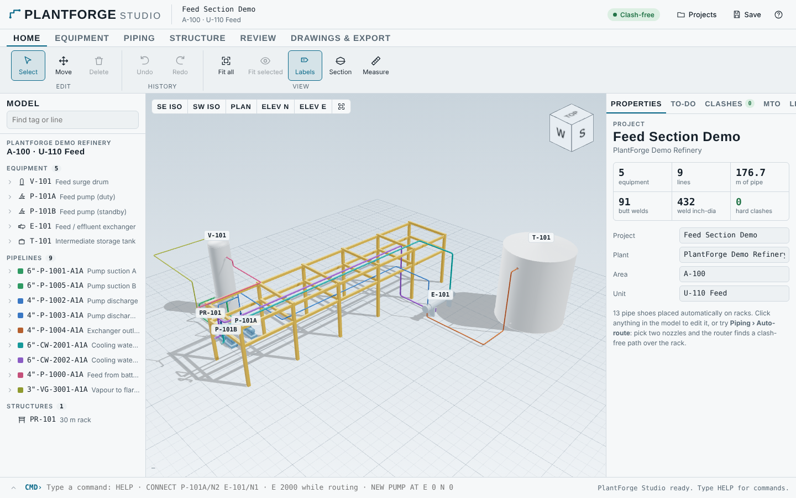
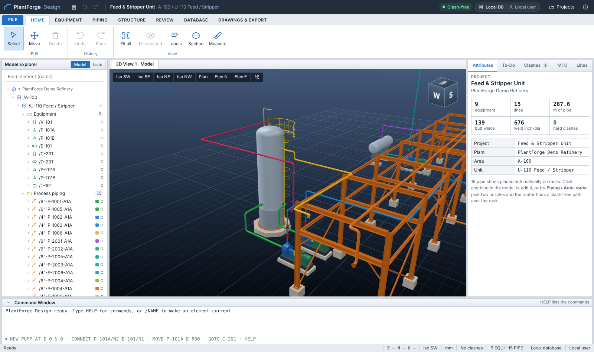
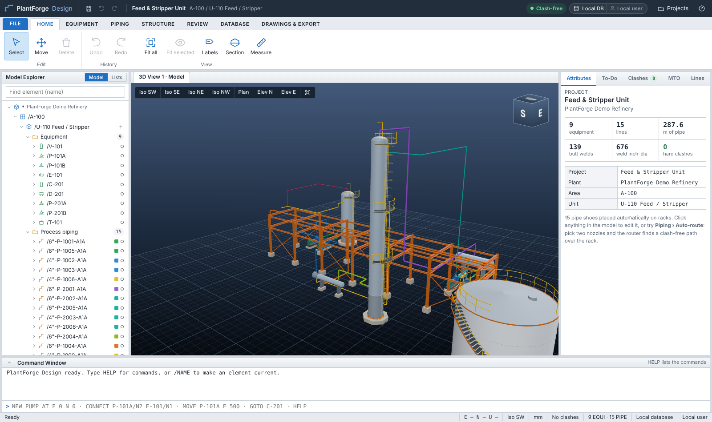
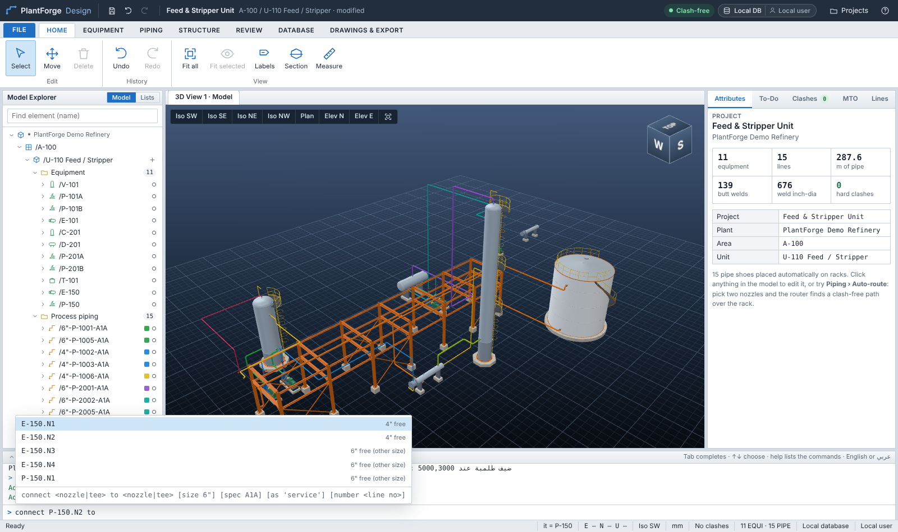
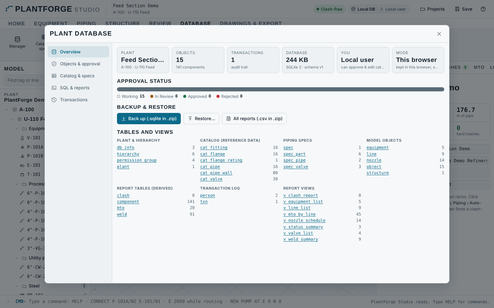
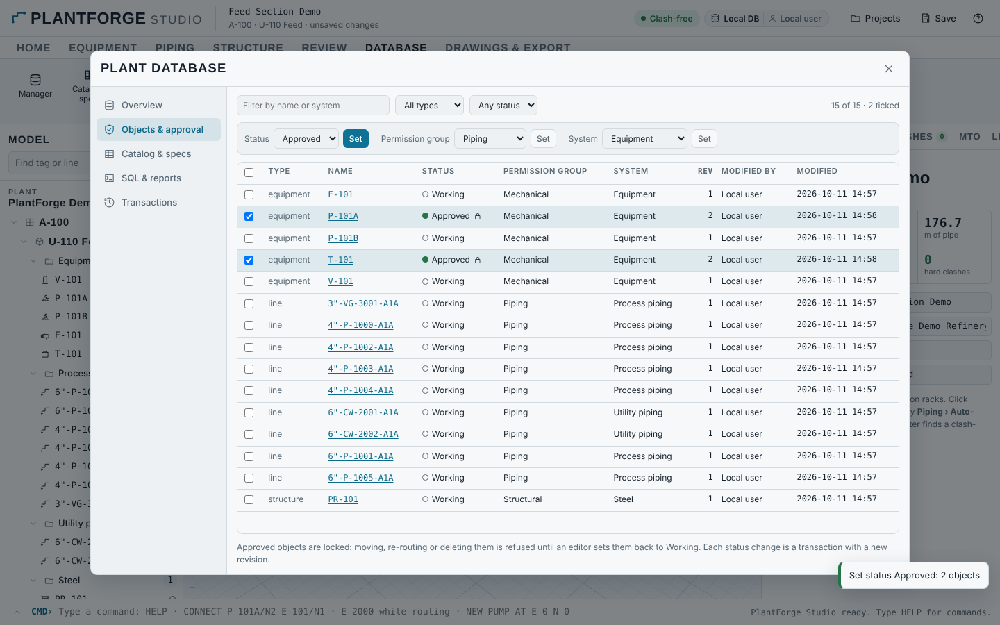

# PlantForge Studio

**برنامج تصميم مصانع وأنابيب تفاعلي ثلاثي الأبعاد، شغّال في المتصفح، على طريقة SP3D و E3D.**

ملف واحد (`release/plantforge-studio.html`). افتحه في أي متصفح حديث، ومحتاج إنترنت بس عشان الخطوط.
وفيه كمان **نسخة Desktop** بتتسطب على Windows و Linux، وبتشتغل Offline، وكل مصنع فيها ملف `.pfdb` على جهازك ([docs/DESKTOP.md](../docs/DESKTOP.md)).
وفيه [قاعدة بيانات للمصنع زي SP3D](#قاعدة-البيانات-plant-database-زي-sp3d): كتالوج، و Approval، و Transactions، و SQL، وشغل جماعي لايف.



## الشكل: Desktop زي E3D

- **3D View:** خلفية Navy متدرجة زي E3D، وإضاءة Headlight، و Ambient occlusion بيظهر أول ما الكاميرا تقف.
  وكل قطعة بلونها: المواسير بلون كل خط، والبلوف حمرا، والحديد برتقالي، والخرسانة رمادي، والـ Handrails صفرا.
- **تفاصيل حقيقية:**
  - مسامير وصواميل كاملة على كل فلانشة.
  - حديد I-beam حقيقي، ومعاه Bracing و Base plates وقواعد خرسانة.
  - طلمبات بـ Casing و Motor بزعانف تبريد، و Coupling guard أصفر، و Plinth.
  - أعمدة وأوعية بـ Platforms و Ladders و Davit.
  - تانك بـ Spiral stair و Roof handrail.
  - الحاجات دي للعرض بس، ومش داخلة في الـ Clash.
- **الواجهة:** Title bar فيه Quick access (Save و Undo و Redo)، و Ribbon بأيقونات ملونة حسب التخصص.
  - **Model Explorer** بشجرة E3D: WORLD ← SITE ← ZONE ← EQUI / PIPE ← BRAN ← ELBO و FLAN و VALV...
  - **Attributes** على شكل Property grid.
  - **Command Window** و Status bar فيه الإحداثيات.
- **لغة أوامر خاصة بالبرنامج:** شوف القسم اللي تحت.





## لغة الأوامر

لغة أوامر خاصة بـ PlantForge، والأمر بيتكتب زي جملة، بالإنجليزي أو بالعربي. المرجع الكامل في [docs/COMMANDS.md](../docs/COMMANDS.md).

```
add pump P-102 at V-101 south 6000 rot 90
connect P-102.N2 to E-101.N1
route from V-101.N2 down 1500 east 3000 to P-101A.N2
set lines where nps>=6 color=blue
isolate C-201 and lines where fluid='Overhead vapour'
ضيف طلمبة عند 5000,3000 ثم لف ده 180
```

- **مراجع سهلة:**
  - النوزل `P-101A.N2`، والتي `P-1002.T1`، والبلف `P-1002.V1`.
  - `it` لآخر حاجة اتعملت.
  - مجموعات زي `pumps` و `lines`، وفلاتر زي `where nps>=6`.
- **إنشاء وتعديل:** معدات بمقاساتها، ونسخ متكررة `x3`، وبلوف و Tees في أي مكان على الخط، ونوزلات، و Systems، وخصائص لمجموعة كاملة مرة واحدة.
- **مواسير:** توصيل تلقائي بين نوزلين، أو رسم بخطوات `east 2000 up 1500` لحد نوزل.
- **أسئلة:** `info` و `list` و `count` و `measure` (المسافة والخلوص)، و `check` و `sql` و `report`.
- **عرض:** `find` و `isolate` و `hide` و `show all` و `section` و `color by status`.
- **إنتاجية:** تسلسل بـ `then`، و `again`، و Macros بمتغيرات `$1`.
- **مساعدة وانت بتكتب:** Tab بيكمّل، والاقتراحات بتفهم السياق (مثلاً بعد `connect … to` بتقترح نوزلات من نفس المقاس الأول). ولو كتبت غلط، البرنامج بيقولك "Did you mean …".



## المميزات

| | |
|---|---|
| **رسم المواسير بالماوس** | ابدأ من نوزل أو من طرف خط مفتوح، وحرّك على المحور. الماسورة والأكواع والفلانشات بتظهر قدامك لحظياً من الـ Spec، مع Snap كل 50 mm ومحاذاة مع النوزلات. ممكن كمان تكتب `E 2000` أو `U 1500` |
| **Auto-routing** | اختار نوزلين، والبرنامج يدوّر على أحسن مسار: من غير Clash، ومفضّل الـ Pipe rack، وبيتجنب الخطوط الطويلة على مستوى الرأس. بيقيّم مئات المسارات المحتملة ويختار الأفضل |
| **معدات بارامترية** | طلمبة، Vertical vessel، Horizontal drum، مبادل حراري، تانك. بتعدّل المقاسات والنوزلات (مقاس، ارتفاع، اتجاه، بروز) من الـ Properties |
| **تحريك بالـ Gizmo** | الخطوط المتوصلة بتتمط مع المعدة وهي بتتحرك (Stretch زي E3D)، والـ Legs بتفضل متعامدة |
| **Pipe racks + Shoes تلقائي** | الـ Rack بيتعمل بارامترياً، وأي ماسورة ماشية عليه بياخد Shoe عند كل Frame لوحده |
| **بلوف و Tees** | Gate و Globe و Check بالـ Hover والضغط على الماسورة. والـ Tee بيبدأ رسم الفرع على طول |
| **Clash لحظي** | GJK على كل القطع والمعدات والحديد، وفيه Clearance اختياري. الـ Clashes بتظهر في الموديل وفي قائمة، وتقدر تعمل Zoom عليها |
| **To-Do list** | أخطاء الـ Routing، والأطراف المفتوحة، واختلاف المقاسات، والمواسير القصيرة. ولكل خطأ زرار Re-route |
| **أيزومتريك فوري** | لأي خط: أبعاد حقيقية، و BOM، ولحامات، و Shoes، وملاحظات الاتصال. تنزيل SVG و DXF |
| **MTO و Line list** | بيتحدّثوا لحظياً، ومعاهم عدد اللحامات والـ Inch-dia |
| **مساعد ذكاء اصطناعي** | اكتب له بالعربي أو الإنجليزي، زي: "ضيف طلمبة احتياطي ووصّلها". هو بيحط المعدات ويوصّل ويضيف البلوف ويعمل Clash check، وكل خطوة ليها Undo |
| **حفظ وتصدير** | حفظ في حسابك على Claude، وحفظ تلقائي في المتصفح. وتصدير Zip فيه PCF و DXF و SVG و MTO و JSON و TOML (لملفات IFC عن طريق محرك Python) |
| **Command Window** | لغة أوامر PlantForge بالإنجليزي أو بالعربي، مع اقتراحات وانت بتكتب (شوف [لغة الأوامر](#لغة-الأوامر)) |
| **مراجعة** | View cube، و Iso من الأربع اتجاهات، و Plan و Elevations، و Section box، و Measure، و Labels، و Color by status، و Undo/Redo بلا حدود |
| **المثال الجاهز** | وحدة Feed و Stripper فيها 9 معدات و 15 خط، وكلها متوصلة بالـ Auto-router من غير ولا Clash: Surge drum وطلمبتين، ومبادل، و Stripper column ارتفاعه 21 m، و Reflux drum وطلمبتين، وتانك، و Pipe rack بدورين |

## قاعدة البيانات (Plant Database) زي SP3D

البرنامج دلوقتي شغّال على **قاعدة بيانات SQLite حقيقية** جوه المتصفح (sql.js). كل حاجة في المصنع متخزنة فيها:
الكتالوج، والـ Specs، والمعدات والخطوط بالـ Metadata بتاعتها، وجداول التقارير، وسجل كل التعديلات.
وتقدر تفتح ملف الـ `.sqlite` بأي أداة SQL (DB Browser، DBeaver، Python، Power BI).



| | |
|---|---|
| **Catalog DB** | جداول `cat_pipe` و `cat_pipe_wall` و `cat_fitting` و `cat_flange` و `cat_valve`. بتعدّل أي رقم من الجريد، والبرنامج يعمل Re-route لكل الخطوط على طول، ويطلّع للـ To-Do أي خط مبقاش راكب |
| **Specs** | `spec` و `spec_pipe` و `spec_part` و `spec_valve` جوه نفس الداتابيز |
| **Bulkload** | زي Excel bulkload في SP3D: صدّر أي جدول CSV، عدّله في Excel، ورجّعه بـ Merge (إضافة وتعديل) أو Replace. ولو الأرقام الجديدة بايظة، الجدول بيرجع زي ما كان |
| **Model DB** | كل Object ليه OID، و Type، و System، و Permission group، و Approval status، و Revision، و Created by / Modified by مع الوقت |
| **Approval workflow** | Working ← In Review ← Approved / Rejected. الـ Object الـ Approved بيتقفل: أي تحريك أو Re-route أو مسح بيترفض لحد ما Editor يرجّعه Working. والـ Approve نفسه للـ Editors بس |
| **System hierarchy** | Area ← Unit ← Systems في الـ Explorer، وتقدر تضيف Systems وتنقل الـ Objects بينها |
| **Transactions** | كل تعديل بيتسجل: مين، وإمتى، وعمل إيه، وأنهي Objects اتأثرت (Audit trail) |
| **SQL & Reports** | كونسول SQL (قراءة بس) و 15 تقرير جاهز: Line list، و Equipment list، و Nozzle schedule، و Valve list، و MTO، و Weld summary، و Clash report، و Approval status، و Audit trail وغيرهم. وكل تقرير يتصدّر CSV، أو كلهم مرة واحدة في Zip |
| **Backup / Restore** | نسخة `.sqlite` كاملة في Zip، وترجّعها في أي وقت. والداتابيز بتتحفظ لوحدها في المتصفح |
| **Color by status** | تلوين الموديل حسب حالة الاعتماد: رمادي Working، وبرتقالي In Review، وأخضر Approved، وأحمر Rejected |



### Shared plant: كذا مهندس على نفس المصنع في نفس الوقت

زي الـ Model database المركزية في SP3D. من **Projects ← Shared plants** تعمل Share للمصنع، وأي حد عنده الصفحة يفتحه ويشتغل عليه معاك:

- **مزامنة لايف:** أي حاجة زميلك يعملها تظهر عندك على طول، ومعاها Toast باسمه وبالتعديل اللي عمله.
- **من غير ما حد يمسح شغل التاني:** كل Transaction بتعمل Lease على الـ Objects اللي بتغيّرها، وبتتأكد إن محدش عدّلهم من آخر مرة شافتهم.
  لو حصل تعارض، التعديل بتاعك ما بيتحفظش، والبرنامج يعرضلك نسخة زميلك ويقولك تعيد تعديلك. ما فيش Overwrite من غير ما تحس.
- **صلاحيات:** الـ Editors بس يقدروا يغيّروا الكتالوج المشترك، والـ Viewers بيشوفوا من غير ما يعدّلوا. والـ Approval بيمشي على الكل.
- **Ids فريدة لكل جلسة:** اتنين بيضيفوا معدات في نفس اللحظة، فمش ممكن يحصل تصادم في الـ Ids.
- الداتابيز بتخزن الـ User ids بس، والأسامي بتتجاب وقت العرض.

> قفل الـ Approved وقفل الـ Lease بيطبّقهم البرنامج نفسه (Cooperative)، والسيرفر بيطبّق بس صلاحية تعديل الكتالوج.
> يعني لو حد كتب في الداتابيز بأداة تانية غير البرنامج، القفلين دول مش هيمنعوه.

## التشغيل من الكود

```bash
cd plantforge/studio
npm install
npm run dev        # تطوير على http://localhost:5173
npm test           # 39 اختبار للمحرك وقاعدة البيانات ولغة الأوامر
npm run build      # dist/plantforge-studio.html (ملف واحد) + dist/artifact.html
```

## نسخة Desktop

```bash
cd plantforge/desktop
npm install
npm run dev        # يبني الواجهة (npm run build:desktop) ويفتح البرنامج في Electron
npm run dist:win   # Installer و Portable لـ Windows
```

التفاصيل في [docs/DESKTOP.md](../docs/DESKTOP.md).

## المعمارية

```
src/engine/    المحرك (TypeScript، مش مربوط بأي واجهة)
  catalog, spec      بيقروا نفس ملفات JSON و TOML بتاعة محرك Python
  routing, parts     Routing من الـ Spec، ونفس نتائج محرك Python (متراجعة مقابل ملفات PCF)
  equipment, structure, compute, connectivity, clash (GJK), autoroute, commands
  mto, pcf, iso, drawing (SVG/DXF), exportToml
  meta               Status و Revision و Who/When لكل Object، وقفل الـ Approved
src/db/        قاعدة البيانات
  schema             جداول SQLite و Views و التقارير الجاهزة
  PlantDB            حفظ وقراءة الموديل والكتالوج، و SQL، و Bulkload، و Backup
  service            ربط الداتابيز بالبرنامج (كل Transaction بتتسجل)
  shared             المصنع المشترك: مزامنة لايف، و Leases، و Version check
src/cmd/       لغة الأوامر: lexer و vocab (إنجليزي + عربي) و world و reader و commands و run و complete
src/viewer/    three.js: المشهد، والأدوات (Route، Insert، Move، Place، Measure)، والـ View cube
src/app/       React: الواجهة، والـ Command line، والـ Store (Undo/Redo)
src/assistant/ أدوات المساعد الذكي
```

ملفات الكتالوج والـ Spec واحدة للمحركين (`plantforge/plantforge/data` و `specs`). يعني أي تعديل في الـ Spec بيظهر في الاتنين.
