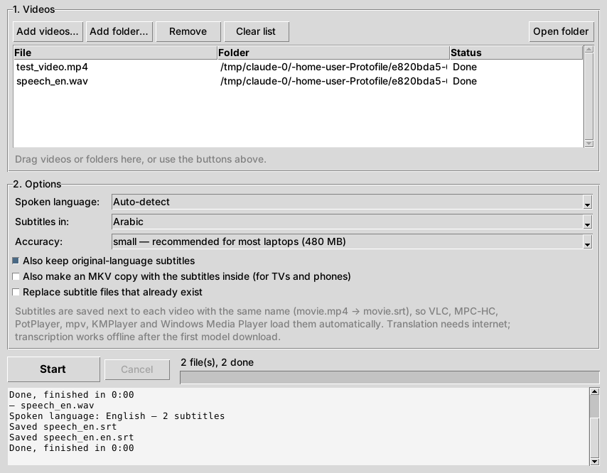

# Subtitle Maker 🎬



برنامج للاب توب بيعمل **ترجمة (Subtitles) لأي فيديو** تلقائيًا: بيسمع الكلام اللي في الفيديو، يكتبه، ولو حبيت يترجمه لأي لغة (عربي مثلًا)، وبعدين يحفظ ملف ترجمة `.srt` جنب الفيديو.

## ليه بيشتغل مع كل المشغلات؟

البرنامج بيحفظ الترجمة **في نفس فولدر الفيديو وبنفس الاسم**:

```
D:\Movies\Inception.mp4
D:\Movies\Inception.srt      ← الترجمة (بتظهر تلقائي)
D:\Movies\Inception.en.srt   ← اللغة الأصلية (اختياري)
```

ودي الطريقة اللي كل المشغلات بتدور بيها على الترجمة، فلما تفتح الفيديو الترجمة بتظهر لوحدها في:
**VLC، MPC-HC، PotPlayer، KMPlayer، mpv، Windows Media Player** وغيرهم.

وكمان فيه اختيار يعمل **نسخة MKV والترجمة جواها** — مفيدة للتلفزيون والموبايل.

## المميزات

- بيتعرف على الكلام بـ **Whisper** (من OpenAI) — بيدعم +90 لغة منها العربي والإنجليزي.
- **بيشتغل أوفلاين** بعد أول مرة (أول مرة بس بينزل ملف الموديل).
- ترجمة للعربي أو أي لغة تانية (عن طريق Google Translate — محتاجة إنترنت).
- واجهة سهلة + **كليك يمين على أي فيديو ← Generate subtitles**.
- تعمل فولدر كامل مرة واحدة (بالفولدرات اللي جواه).
- بيقسم الكلام لسطور مقرية (مش أكتر من سطرين وحوالي 7 ثواني للسطر).
- بيظبط علامات الترقيم في العربي عشان متظهرش في الناحية الغلط.
- بيدعم كارت شاشة **NVIDIA** (أسرع بكتير) — شغّل `install-gpu.bat` مرة واحدة.

## التثبيت على الويندوز

1. نزّل **Python 3.12** من [python.org/downloads](https://www.python.org/downloads/)
   وفي أول شاشة في التثبيت علّم على **"Add python.exe to PATH"**.
2. نزّل فولدر `subtitle-maker` ده على جهازك (مثلًا `C:\SubtitleMaker`).
3. دبل كليك على **`setup.bat`** واستنى لحد ما يخلص (بينزل حوالي 250 ميجا أول مرة بس).

خلاص! هتلاقي **Subtitle Maker** على الديسكتوب وفي قايمة Start.

## الاستخدام

### 1) من الواجهة

1. افتح **Subtitle Maker**.
2. دوس **Add videos…** أو **Add folder…** (أو اسحب الفيديوهات على البرنامج).
3. اختار:
   - **Spoken language**: لغة الكلام في الفيديو (أو سيبها Auto-detect).
   - **Subtitles in**: لغة الترجمة اللي عايزها — مثلًا **Arabic**.
   - **Accuracy**: الدقة (شوف الجدول تحت).
4. دوس **Start**.

لما يخلص، افتح الفيديو في VLC والترجمة هتظهر لوحدها.

### 2) من الكليك يمين

كليك يمين على أي فيديو (أو فولدر فيه فيديوهات) ← **Generate subtitles**.
في ويندوز 11 هتلاقيها تحت **Show more options**.
بيستخدم آخر إعدادات اخترتها في الواجهة. ولو اخترت كذا فيديو مرة واحدة بيتعملوا ورا بعض في نفس النافذة.

### 3) من سطر الأوامر (للي بيحب الـ Terminal)

```bat
.venv\Scripts\subtitle-maker "D:\Movies\film.mp4" --to ar
.venv\Scripts\subtitle-maker "D:\Series" --model medium --to ar --embed
```

| الأمر | المعنى |
|---|---|
| `--to ar` | ترجم للعربي (`en` إنجليزي، `fr` فرنساوي، …) |
| `-l en` | لغة الكلام في الفيديو (من غيره بيتعرف عليها لوحده) |
| `-m medium` | الدقة / الموديل |
| `--embed` | اعمل كمان نسخة `.subtitled.mkv` والترجمة جواها |
| `--no-original` | متحفظش ملف اللغة الأصلية لما تترجم |
| `--overwrite` | اكتب فوق ملفات الترجمة الموجودة |
| `--device cpu` | متستخدمش كارت الشاشة |

## اختيار الدقة (Accuracy)

| الموديل | الحجم | السرعة | إمتى أستخدمه |
|---|---|---|---|
| tiny | 75 MB | سريع جدًا | تجربة سريعة بس |
| base | 145 MB | سريع | كلام واضح |
| **small** | 480 MB | متوسط | **مناسب لمعظم اللابتوبات (الافتراضي)** |
| medium | 1.5 GB | أبطأ من small بحوالي 3 مرات | **أحسن للعربي واللهجة المصري** |
| large-v3-turbo | 1.6 GB | سريع على كارت شاشة | دقة عالية جدًا، محتاج جهاز قوي أو GPU |
| large-v3 | 3 GB | الأبطأ | أعلى دقة |

> على لابتوب من غير كارت شاشة، `small` ممكن ياخد تقريبًا من ربع لنص مدة الفيديو حسب قوة الجهاز.
> مع كارت NVIDIA الموضوع بيبقى أسرع بكتير.

## لو بطيء

- **وصّل الشاحن.** الويندوز بيبطّأ البروسيسور لما اللاب يبقى على البطارية، والبرنامج بيبقى أبطأ بكتير.
- **قلّل الدقة:** `medium` أبطأ من `small` بحوالي 3 مرات، و`base` أسرع من `small` بحوالي مرتين.
- **اقفل البرامج التقيلة** (الكروم بتابات كتير، الألعاب) وانت شغال.
- **لو عندك كارت NVIDIA** شغّل `install-gpu.bat` مرة واحدة، وده أكبر فرق في السرعة.
- **أول مرة بس** بتطوّل عشان تحميل الموديل؛ المرات اللي بعدها أسرع.
- فوق شريط التقدم هتلاقي **الوقت الفاضل** تقريبًا.

## لو الترجمة مظهرتش في VLC

- اتأكد إن ملف `.srt` في **نفس الفولدر** وبنفس اسم الفيديو.
- في VLC: من قايمة **Subtitle ← Sub Track** اختار الترجمة.
- أو اسحب ملف `.srt` وارميه على VLC وهو شغال.
- أو: **Tools ← Preferences ← Subtitles / OSD** واتأكد إن **Autodetect subtitle files** متعلّم عليها.
- لو العربي ظاهر مربعات: من نفس الصفحة غيّر الخط لـ **Arial** أو **Tahoma**.

## أسئلة

**هل الفيديو بيترفع على النت؟**
لأ. الصوت بيتسمع ويتكتب على جهازك. الترجمة بس (لو اخترتها) بتبعت **النص** لـ Google Translate.

**أول مرة طوّل جدًا؟**
طبيعي — أول مرة بينزل ملف الموديل (من 75 ميجا لـ 3 جيجا حسب الدقة). بعد كده بيشتغل على طول ومن غير نت.

**الترجمة فشلت؟**
لو مفيش نت، البرنامج بيحفظ الترجمة باللغة الأصلية وبيكتبلك في الـ log.

**عندي كارت NVIDIA، أشغّله إزاي؟**
دبل كليك على `install-gpu.bat` (بينزل حوالي 1.3 جيجا مرة واحدة). بعدها هتلاقي في الـ log
`Loading model ... on CUDA`. لو الكارت مش مدعوم البرنامج بيرجع للـ CPU لوحده.

**على ماك أو لينكس؟**
بيشتغل برضه: `pip install -e .` وبعدين `subtitle-maker` (من غير الكليك يمين).

## إزالة البرنامج

دبل كليك على `uninstall.bat` (بيشيل الكليك يمين والاختصارات)، وبعدين امسح الفولدر.
ملفات الموديلات موجودة في `%USERPROFILE%\.cache\huggingface` لو عايز تمسحها توفر مساحة.

---

## للمطورين

```
subtitle_maker/
  core.py        # Whisper → cues → (translate) → .srt → (mkv)
  subtitles.py   # تقسيم الكلام لسطور مقرية + كتابة SRT
  translate.py   # Google Translate على دفعات
  embed.py       # دمج الترجمة في MKV بـ ffmpeg
  gui.py         # الواجهة (tkinter)
  instance.py    # نافذة واحدة لما تفتح كذا فيديو من الكليك يمين
  windows.py     # الكليك يمين + الاختصارات (Registry تحت HKCU)
  cli.py         # سطر الأوامر
```

تشغيل الاختبارات:

```bash
pip install -e ".[test]"
pytest
```
